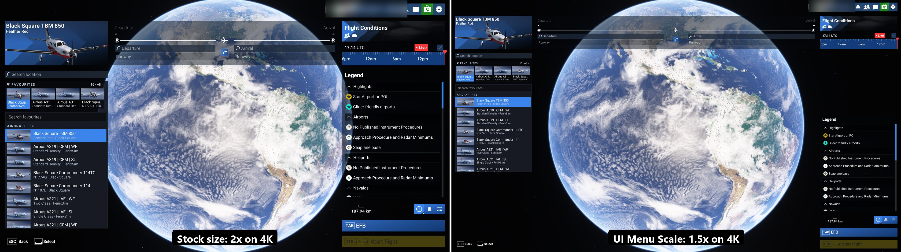
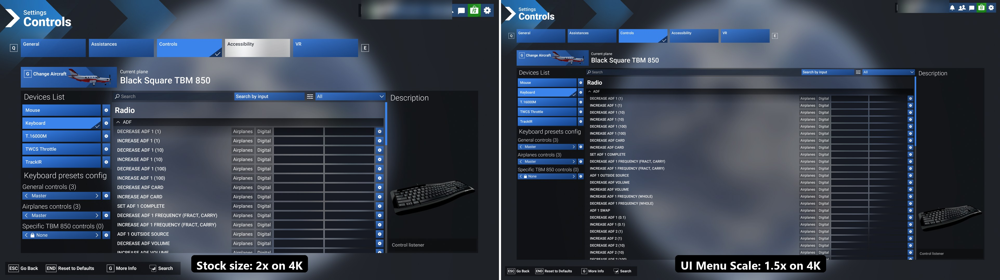
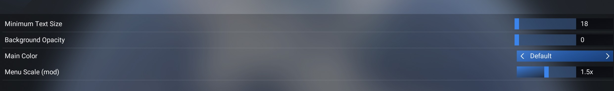

# UI Menu Scale for MSFS 2024

Smaller, denser menus for Microsoft Flight Simulator 2024 on high-resolution screens. The stock menus are drawn at 2x on a 4K screen and 1.33x at 1440p, so large text and wide margins eat the screen. This mod keeps the stock UI exactly as designed and only draws it at a smaller scale, while still filling the screen. The scale can be adjusted in the sim's own Settings.

| Screen | Stock | With the mod (default) |
|---|---|---|
| 4K (2160p) | 2x | 1.5x |
| 1440p | 1.33x | 1x |
| 1080p | 1x | 1x (unchanged) |

> **Works with [SimpleUI](https://flightsim.to/addon/116742/simpleui-there-i-fixed-msfs-ui-for-you).** Use both together: SimpleUI cleans up the menus, UI Menu Scale sets their size.

## Install

1. Download `paulcharp-ui-menu-scale-<version>.zip` from [flightsim.to](https://flightsim.to/addon/116999/ui-menu-scale) or [GitHub Releases](https://github.com/paul-charp/MSFS2024-UI-Menu-Scale/releases).
2. Extract it into your Community folder, so you get `Community/paulcharp-ui-menu-scale/manifest.json`.
3. Start the sim.

To uninstall, delete the `paulcharp-ui-menu-scale` folder.

## Adjust the scale

**Settings › Accessibility › User interface and font › Menu Scale (mod)**, the last line of that page.

- Drag or click the bar, use the mouse wheel, or Left / Right while the mouse is over it. The menus redraw when you release.
- The value shows the scale you get on your screen (e.g. 1.5x on 4K).
- Your choice is saved by the sim and kept across restarts.

The slider sets the **density**: the layout height divided by your screen height, from 0.5 to 1. Menus are never drawn below the stock 1080p size.

| Density | 4K | 1440p |
|---|---|---|
| 0.5 | 1x | 1x |
| 0.67 | 1.33x | 1x |
| 0.75 (default) | 1.5x | 1x |
| 0.85 | 1.7x | 1.13x |
| 1 | 2x (stock) | 1.33x (stock) |

The default is in `Community/paulcharp-ui-menu-scale/html_ui/paulcharp-ui-menu-scale/settings.json` (`{"density": 0.75}`). Changing that file resets the value set with the slider.

## Compatibility

- MSFS 2024 on PC. The stock **Interface Scale** and **Minimum Text Size** settings still apply on top.
- Applies to the menus, world map and notifications. The toolbar, in-game panels and the EFB keep their stock size.
- Works with [SimpleUI](https://flightsim.to/addon/116742/simpleui-there-i-fixed-msfs-ui-for-you), tested with 1.0.11.
- Mods that replace the same stock UI components conflict with this one: `TitlePage`, `Shortcut`, `Notification_Gameplay`, `Worldmap_Pin`. Only one of the two works.
- After a sim update that changes one of these components, the mod may need an update.

## Known limits

- The Menu Scale line works with the mouse only (no gamepad focus), and its label is in English.
- The layout is spread back to the screen edges by a heuristic; an unusual page may look off. Please report it with a screenshot.

## Links

- flightsim.to: [UI Menu Scale](https://flightsim.to/addon/116999/ui-menu-scale)
- Changelog: [CHANGELOG.md](CHANGELOG.md)
- How it works, building from source: [docs/DEVELOPMENT.md](docs/DEVELOPMENT.md)
- Issues: [GitHub issues](https://github.com/paul-charp/MSFS2024-UI-Menu-Scale/issues)

## License

[MIT](LICENSE) for the mod's own code. The release zip also contains four stock MSFS UI components, each with a one-line hook added; those remain Microsoft / Asobo's.
